  

## I build tools for curious people.

Hey, I'm **Giuseppe** — a developer, open-source maintainer and incurable tinkerer from Italy. I write **Python**, run **Linux** and enjoy finding out how things work. The terminal is usually open.

I'm into **system administration, networking and security**: configuring services, self-hosting with **Docker** and spending an evening automating a five-minute task. Time well spent. Probably.

When I'm away from the terminal, there's usually an **ESP32, Arduino or Raspberry Pi** nearby. And a USB cable that may or may not carry data.

### The really cool stuff.

**[Resource Monitor](https://github.com/0ry0n/Resource_Monitor)** · Creator & maintainer  
CPU, memory, disk, network and GPU metrics in your GNOME top bar. For when “the fan sounds busy” isn't quite enough information.  
`JavaScript` `GNOME Shell` · [Install](https://extensions.gnome.org/extension/1634/resource-monitor/) · [Releases](https://github.com/0ry0n/Resource_Monitor/releases)

**[HeartBest](https://github.com/0ry0n/HeartBest)** · Personal project  
An Android experiment in estimating heart rate from camera images with OpenCV.  
`Android` `OpenCV`

### A little code, somewhere else.

**[OpenWeatherMap Go](https://github.com/briandowns/openweathermap)** · Contributor  
Contributed [One Call API support](https://github.com/briandowns/openweathermap/pull/101), along with a [visibility field and HTTPS update](https://github.com/briandowns/openweathermap/pull/100). Both pull requests were merged upstream.  
`Go` `API integration`

### On GitHub

<!-- STATS:START -->
| Stars on original repos | Forks of original repos | Public repositories |
| :---: | :---: | :---: |
| **229** | **42** | **9** |

Public data · checked 2026-11-21. Stars and forks exclude forked repositories.
<!-- STATS:END -->

---

**Open to work & collaborations.** Building something with Linux, Python, infrastructure or IoT? I'd love to hear about it.

<!-- Replace the LinkedIn and website placeholders with your own URLs. -->
[LinkedIn](https://it.linkedin.com/in/giuseppesilvestro) · [Website](https://0ry0n.github.io/) · [Fuel the next side project → GitHub Sponsors](https://github.com/sponsors/0ry0n)
